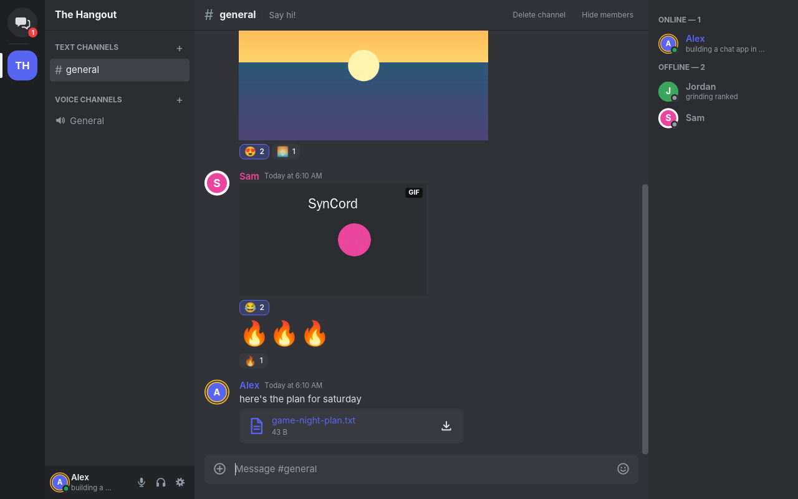
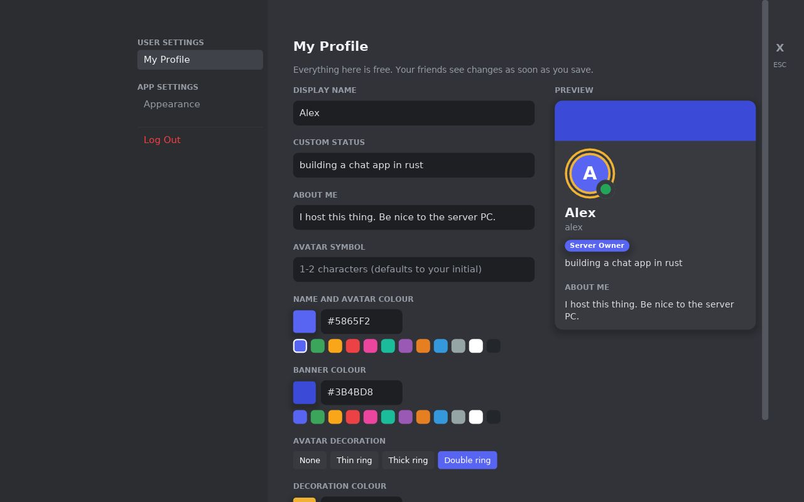
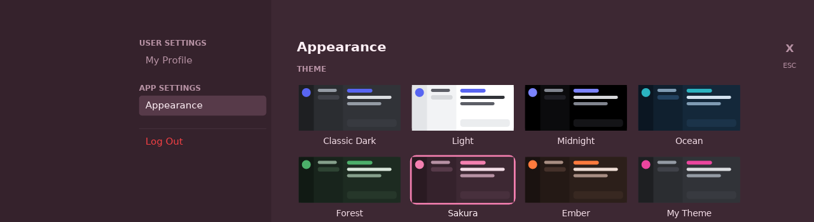
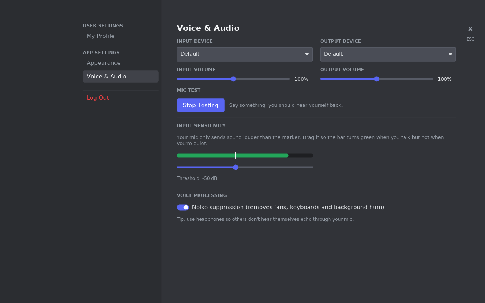

# Celerity

A lightweight, self-hosted chat app for you and your friends, written entirely in Rust.
It has text and voice channels and looks and feels like the chat apps you're used to, but it's a
native program instead of a web browser in disguise, so it's tiny, and every customization
feature is free.

> Celerity used to be called **SynCord**. Apps and servers from then update to Celerity by
> themselves and keep their settings, accounts, messages and invite codes.



## Why

| | Celerity | Typical Electron chat app |
|---|---|---|
| Client memory (one server, pictures on screen) | **~30–45 MB** (low memory mode) | 300 MB to 1 GB+ |
| Client memory (in a voice call) | **+2 MB** | higher still |
| Client download | ~6 MB installer | 100 MB+ installer |
| Server memory | under 50 MB | n/a (someone else's cloud) |
| Themes, profile colours, avatar rings | free | paid |
| Who owns your messages | you (one SQLite file) | them |

Numbers were measured on Linux with the release build. In low memory mode (the default)
the client draws on the CPU, which avoids the GPU driver's memory overhead. You can turn it
off in **Settings → Appearance** for GPU rendering.

## Features

- **Discord-style layout**: server bar, channel list, chat, member list, user panel
- Real-time text chat with message grouping, edit/delete, typing indicators, unread channels;
  **Shift+Enter** for new lines, Up to edit your last message
- **@mentions** of people, roles and @everyone, with highlighted messages, red badges and a ping sound
- **Links** are clickable and get preview cards (title, description, picture), fetched by the
  server so your friends' addresses aren't shared with every website
- **Statuses**: Online, Idle (automatic after 10 minutes away), Do Not Disturb (no sounds or
  pings) and Invisible, plus "Playing ..." / "Watching ..." / "Listening to ..." that you type or
  that Celerity fills in from the game you're running (Steam, Epic, GOG, Riot and Xbox games)
- **Replies**, **markdown** (bold, italic, code blocks, quotes, lists...) and **pinned messages**
- Links ask before opening, showing the real website (and can remember trusted sites)
- Undo/redo and a right-click menu in the message box
- **Message search** (Ctrl+F) with `from:`, `in:` and `has:link|file|image|video`; click a result
  to jump to it in the conversation
- Clickable profile cards
- **Closes to the tray** on Windows and Mac (optional), so messages and calls still reach you;
  starting Celerity again brings back the running copy
- **Right-click anyone** for Profile, Message, Start a Call, Roles, Ignore, Block, Copy Username/ID
- **Profile customization**: display name, pronouns, custom status, bio, name/avatar colour,
  **profile picture and banner** (pictures or animated GIFs, cropped Discord-style), banner colour,
  avatar symbol, and decorative avatar rings (thin, thick, double) in any colour
- **Themes**: 7 built-in (Classic Dark, Light, Midnight, Ocean, Forest, Sakura, Ember), plus
  your own `.toml` theme files with every colour editable
- Text size slider and compact mode
- Invite-code sign-up so strangers can't join; the first account becomes the server owner
- **Roles** with colours, their own section in the member list, and permissions (manage
  channels, manage roles, delete messages, mention @everyone, send messages and files, join voice...)
- **Keyboard shortcuts** like Discord's (Ctrl+K quick switcher, Alt+Up/Down, Ctrl+Shift+M...);
  Ctrl+/ lists them
- **Encrypted connections**, including voice: the app remembers each server's identity the first
  time it connects and refuses an impostor after that
- **Several servers at once**: each has an icon in the left rail with its unread dot and pings;
  **+** signs in to another. A call keeps going while you look at another server
- **Threads**, **polls**, **custom emoji and stickers**, and **categories** you can collapse and
  drag to reorder, with **private channels** for chosen roles
- **Desktop notifications** for DMs and @mentions (or everything), and **mute** for any channel,
  conversation or server (right-click it)
- Messages appear the moment you send them; channels load in the background; short connection
  drops are invisible (and it rejoins your voice call); stays logged in between launches
- Unread markers that are remembered between launches, and a "new messages" bar with a jump to
  the first one
- **Invite links** (`celerity://join/...`), **kick and ban**, and an **admin page** for owners

### Pictures, GIFs and files

- Send pictures and files with the **+** button, by **dragging** them into the window, or by
  **pasting** (Ctrl+V / Cmd+V): take a screenshot (Win+Shift+S, Print Screen, Cmd+Ctrl+Shift+4)
  and paste it, or copy files in File Explorer / Finder and paste them
- Files up to **1 GB**, sent and saved in pieces so big ones don't fill your memory, with
  progress bars both ways
- Pictures show in the chat; click one to see it full size, save it, or **copy** it (Ctrl+C)
- **GIF search** in the GIF tab of the emoji picker, powered by GIPHY or KLIPY (the server owner
  adds a free key, see [GIF search](#gif-search)); click one to send it
- **GIFs** play right in the chat (or only when you point at them, if you prefer), and you can
  **star** GIFs to keep them in your favourites for quick re-sending
- Other files (documents, zips, videos, ...) show as a card with a download button
- The server makes small previews, so the app only ever downloads and keeps small pictures in
  memory (with a cap, so a channel full of GIFs can't eat your RAM)

### Emoji and reactions

- Emoji picker with search, categories and recently used
- Type `:fire:`-style codes; suggestions pop up as you type (Enter picks the top one)
- **Reactions**: hover a message and click the smiley, or click an existing reaction to add yours.
  Hover a reaction to see who reacted
- Messages that are only emoji show big
- **Twemoji**, the emoji Discord uses, bundled so they look the same on every computer

### Direct messages

- The **Home** button (top-left) holds your private conversations, with an unread badge
- Start one with **Message** on anyone's profile card, or the **+** next to *Conversations*
- **Calls**: the phone button in a conversation (or right-click → Start a Call) rings the other
  person, and leaves a note in the chat (how long it lasted, or that it was missed)
- **Group messages** with 3 to 10 people (the **+** next to *Conversations*), with group calls
- **End-to-end encrypted**: when everyone has Celerity 0.7 or newer, messages and calls in DMs and
  groups can only be read or heard by the people in them; not even whoever runs the server can (a
  lock in the header shows it). Files aren't end-to-end encrypted yet

### Voice chat

- **Voice channels** with everyone in them listed underneath, and a green ring around whoever is talking
- **Opus** audio at 64 kbps (the codec the big apps use), with error correction for lost packets
- **Noise suppression** (an RNNoise port) that removes fans, keyboard clatter and hum
- **Voice activity detection** with an adjustable sensitivity and a live level meter, so you
  only send audio while you're talking
- **Push to talk** with any key or mouse side button, working while a game is in front (on macOS
  this needs Input Monitoring; on Wayland it works while Celerity is in front)
- **Echo cancellation** (WebRTC's AEC3), so others don't hear themselves through your speakers
- **Soundboard**: short sounds the server adds, played into the call
- A **connection meter** (ping and audio lost) and a "You're muted" reminder when you talk muted
- **Mute and deafen** buttons, shown to everyone in the channel; call timers
- Moderators can **move people** between voice channels (drag them) and **server-mute** them
- **Per-person volume** up to 200%: click someone in your call to turn them up or down
- Pick your microphone and speakers, input and output volume, and a **mic test** that plays you back
- Uses **UDP** for the lowest delay and switches automatically to the normal connection if UDP is
  blocked, so voice still works through strict networks and HTTPS proxies
- A jitter buffer smooths out network hiccups

### Video and screen sharing

- **Camera** and **Screen** buttons in every call (voice channels and DM calls)
- Share a **whole screen or a single window**, at up to **1440p 60 fps** (the default) or your
  screen's own resolution up to 4K; the server only sends it to people who click **Watch Stream**
- **With sound**, in stereo at music quality: the shared window's app on Windows and Mac, or
  everything your computer plays except the call. Each watcher has their own volume slider
- Cameras at up to **1080p**, shown for everyone in the call; click a video to make it big
- H.264, encoded by your **graphics card** when it can (NVIDIA, AMD, Intel, Apple), otherwise by
  OpenH264, with the operating system's own capture: no extra installs. Watched video is decoded
  to YUV and turned into colour on the graphics card. Encrypted like voice (end to end in DMs)
- About 12 Mbit/s for 1440p60 and 3.5 Mbit/s for a 1080p camera, and very little while a screen
  doesn't change
- Linux: screen sharing needs an X11 session (Wayland isn't supported yet); the computer's sound
  includes the call there, so it's off by default; cameras work anywhere

| Profile settings | Themes | Voice settings |
|---|---|---|
|  |  |  |

---

## Getting the apps

**Download the latest release:** <https://github.com/bxpo/SynCord/releases/latest>

Send that link to your friends. The release page explains which file each person needs:

| | Everyone (to chat) | The host PC (to run the server) |
|---|---|---|
| **Windows** | `Celerity-Setup-x.y.z.exe` | `Celerity-Server-Setup-x.y.z.exe` |
| **Mac** | `Celerity-x.y.z-macOS.dmg` (Intel and Apple Silicon) | `Celerity-Server-x.y.z-macOS.zip` |
| **Ubuntu / Debian** | `celerity_x.y.z_amd64.deb` | `celerity-server_x.y.z_amd64.deb` |
| **Other Linux** | `celerity-x.y.z-linux-x86_64.tar.gz` | `celerity-server-x.y.z-linux-x86_64.tar.gz` |

- The **Windows server installer** does the whole hosting setup: it starts the server with Windows,
  opens the firewall and shows the invite code. On Ubuntu/Debian the server `.deb` sets up a
  background service the same way.
- The apps aren't signed with paid certificates. **Windows** may say *"Windows protected your PC"*
  (click **More info → Run anyway**), and **macOS** needs you to allow the app the first time
  (macOS 15+: **System Settings → Privacy & Security → Open Anyway**; older: right-click → **Open**).
- **Phones and tablets**: open your server's address in the phone's browser (for example
  `http://192.168.1.20:7878`) and add it to the Home Screen. The web app has text channels, DMs,
  pictures and files, voice and notifications (see [web/README.md](web/README.md)). Video,
  screen sharing and the newer 0.7 features are in the desktop app.

### Automatic updates

Celerity keeps itself up to date:

- **The app** checks for a new release a few seconds after it opens and every few hours after
  that, downloads it in the background, then shows a popup: *Updating Celerity to x.y.z in 10
  seconds*. It installs on its own and reopens (or click **Update now**; **Later** installs it the
  next time you open Celerity). If you're in a voice call, it waits until you leave.
  - Windows and Mac update completely by themselves.
  - Linux: the portable `.tar.gz` copy updates itself; the `.deb` package shows a download button
    (installing system packages needs your password).
  - **Settings → Appearance → Updates** shows your version and has a *Check for updates* button.
- **The Windows server** checks every 6 hours and installs new versions when nobody is connected.
  Turn this off with `auto_update = false` in its settings. Servers on Linux and Mac write a note
  in their log instead.
- Every release is **signed**. Apps and servers check the signature before installing anything,
  so a tampered or fake download is refused.

Apps and servers from before v0.3.0 don't have the updater, so install v0.3.0 by hand once.

### Making a new release

Change `version` in `Cargo.toml` and add a section for it to `CHANGELOG.md`, push, then on GitHub
open **Actions → Release → Run workflow**. It builds every installer, tests the Windows ones on a
real Windows machine, signs everything, and publishes a release named after the version. Every
Celerity app and server then updates itself.

Signing needs the private release key saved as a repository secret named `SYNCORD_UPDATE_KEY`
(Settings → Secrets and variables → Actions). Keep a backup of that key somewhere safe: without
it, future releases can't be installed automatically. Releases made without it still work as
manual downloads. The packaging scripts are in [`packaging/`](packaging/).

**From source:** install Rust from <https://rustup.rs> and [CMake](https://cmake.org) (used to
build the Opus audio codec). On Linux, also install the ALSA headers (`libasound2-dev` on
Debian/Ubuntu, `alsa-lib-devel` on Fedora). Then:

```bash
cargo build --release
```

The programs end up in `target/release/`.

---

## Hosting on a friend's PC

### 1. Start the server

Put `celerity-server` (`celerity-server.exe` on Windows) in its own folder, for example
`C:\Celerity`, and run it once. It creates two files next to itself:

- `celerity-server.toml`: the settings
- `celerity.db`: the database that holds all accounts, channels and messages
- `uploads/`: pictures and files people send, and the server's emoji, stickers and sounds
- `backups/`: a copy of the database from each of the last 7 days (see [Backups](#backups))

(With the Windows installer they're in `C:\ProgramData\Celerity Server` instead.)

The console prints the **invite code** your friends need to sign up. Open
`celerity-server.toml` to change it or to rename the server:

```toml
bind = "0.0.0.0:7878"          # listen on port 7878 on every network card
community_name = "The Hangout" # shown at the top of the channel list
invite_code = "pick-something" # needed to create an account; "" lets anyone sign up
database = "celerity.db"
uploads = "uploads"            # folder for pictures and files people send
max_upload_mb = 1024           # biggest file people can send (1 GB)
auto_update = true             # install new server versions by itself (Windows)
backups = true                 # copy the database into backups/ once a day
public_address = ""            # e.g. "chat.example.com:7878", used in invite links
giphy_api_key = ""             # for GIF search, see below
klipy_api_key = ""
```

Settings files from older versions get the new settings added automatically the first time the
new server starts.

Restart the server after editing. To check it's running, open <http://localhost:7878> on that
PC. It should say *Celerity server is running.*

Big files take up disk space on the server PC; lower `max_upload_mb` if that's a worry.

#### GIF search

GIF search goes through the server, so only the server owner needs a key, and it's free. Pick
one service:

- **GIPHY**: sign in at <https://developers.giphy.com/dashboard/>, click *Create an App*, choose
  *API*, give it any name, and copy the API key. New keys allow a limited number of searches an
  hour, which is plenty for a group of friends.
- **KLIPY**: sign up at <https://partner.klipy.com/>, create an app, and copy its API key.

Paste the key into the settings file, for example `giphy_api_key = "abc123..."`, save, and
restart the server (on Windows: Start menu → *Celerity Server* → *Restart server*, or restart the
PC). The GIF tab in everyone's emoji picker now has a search box. If both keys are set, GIPHY is
used.

### 2. Let your friends reach it

Pick **one** of these.

#### Option A: Tailscale (recommended)

[Tailscale](https://tailscale.com) is free for personal use. It puts everyone's PCs on a
private, encrypted network, so there's no router setup and nothing exposed to the internet.

1. Install Tailscale on the server PC and on each friend's PC, signed in to the same tailnet.
   Or install it on the server PC only and [share that machine](https://tailscale.com/kb/1084/sharing)
   with your friends' accounts.
2. Find the server PC's Tailscale address (it looks like `100.x.y.z`) in the Tailscale app.
3. Everyone types that address into Celerity's **Server address** box.

#### Option B: Port forwarding

1. In the router's settings, forward port **7878** for both **TCP** (chat) and **UDP** (voice)
   to the server PC's local IP address. If you can only forward TCP, voice still works over
   TCP, just with slightly more delay.
2. Allow the port through the firewall. On Windows, run these in an admin PowerShell:

   ```powershell
   New-NetFirewallRule -DisplayName "Celerity" -Direction Inbound -Protocol TCP -LocalPort 7878 -Action Allow
   ```

   ```powershell
   New-NetFirewallRule -DisplayName "Celerity voice" -Direction Inbound -Protocol UDP -LocalPort 7878 -Action Allow
   ```
3. Friends use your home's public IP address (search "what is my IP" on the server PC).

> **Heads up:** with plain port forwarding, traffic (including passwords) is not encrypted.
> Tailscale avoids this. If you'd rather use port forwarding, put a reverse proxy such as
> [Caddy](https://caddyserver.com) in front of Celerity with a domain name. Caddy gets an HTTPS
> certificate automatically, and friends then connect with `wss://your.domain`. Voice then
> travels through the same encrypted connection.

On the same Wi-Fi as the server you can always use its local IP (e.g. `192.168.1.20`).

### 3. Keep it running

**Windows:** open *Task Scheduler* and choose **Create Task**:
- *Triggers*: **At startup**
- *Actions*: **Start a program**, pointing to `C:\Celerity\celerity-server.exe`, with
  *Start in* set to `C:\Celerity`
- *General*: tick **Run whether user is logged on or not**

**Linux:** create `/etc/systemd/system/celerity.service`:

```ini
[Unit]
Description=Celerity chat server
After=network-online.target

[Service]
WorkingDirectory=/opt/celerity
ExecStart=/opt/celerity/celerity-server
Restart=always
User=celerity

[Install]
WantedBy=multi-user.target
```

Then run:

```bash
sudo systemctl enable --now celerity
```

**Docker / CasaOS:** every release publishes a server image, `ghcr.io/bxpo/celerity-server`.

- **CasaOS:** App Store → **+** → *Install a customized app* → *Import*, and paste in
  [`docker-compose.yml`](docker-compose.yml). Settings, database, backups and uploads are kept in
  `/DATA/AppData/syncord` (the name from before Celerity was renamed, so existing servers keep
  their data); the invite code is in `celerity-server.toml` there.
- **Docker:**

  ```bash
  docker run -d --name celerity-server --restart unless-stopped -p 7878:7878/tcp -p 7878:7878/udp -v ./data:/data ghcr.io/bxpo/celerity-server:latest
  ```

To update, pull the new image and recreate the container (in CasaOS, update the app). The server
in a container doesn't update itself; it writes a line in its log when a new version is out.

**Automatic updates with Docker (optional):** [`docker-compose.yml`](docker-compose.yml) includes
a [Watchtower](https://github.com/nicholas-fedor/watchtower) service that's off unless you ask for
it. Turned on, it checks for a new Celerity image every day at 04:00 and restarts Celerity on it
(your data stays in the volume). It only updates containers labelled
`com.centurylinklabs.watchtower.enable=true`, which in this file is just Celerity, so your other
containers are left alone. Turn it on with:

```bash
docker compose --profile autoupdate up -d
```

and off again with `docker compose stop watchtower`. A restart drops everyone from voice for a
few seconds, so 04:00 is a good time for it. In CasaOS, use the app's *Check then update* instead.

### 4. Create accounts

Open `celerity`, click **Register**, enter the server address, a username, a password and the
invite code. **The first account created becomes the server owner**, so the host should
register first. Only the owner can create and delete channels, until they hand out roles.

#### Invite links

Instead of sharing the server-wide invite code, the owner (and anyone with a role that has
**Create invites**) can make invite links, in the app or on the [admin page](#the-admin-page).
A link can stop working after a while or after a number of uses, and can be revoked at any time.
It looks like `celerity://join/chat.example.com:7878/AbC123xyz0`: clicking it opens Celerity
with the server and invite filled in. The server also serves a small web page for each invite,
`http://<server>:7878/invite/<token>`, with an **Open in Celerity** button and a download link,
for places where `celerity://` links aren't clickable. The token itself also works in the app's
invite box. The old invite code keeps working alongside invite links.

Links use the address you connected to when you made them. If friends reach the server under a
different name (a domain, or a Tailscale name), put it in `public_address` in the settings file.

#### Kicking and banning

People with **Kick members** can remove someone ranked below them: they're signed out and can
come back by registering again with their username, password and a new invite. **Ban members**
removes them for good, until someone unbans them. Their old messages stay. Both work in the app
and on the admin page.

### The admin page

Open `http://<server>:7878/admin` in a browser (on the server PC: <http://localhost:7878/admin>)
and sign in with the **owner's or an administrator's** Celerity username and password. It shows:

- who's online right now,
- how much space the database and uploads take, and how much is left on the disk,
- invite links (make new ones, revoke old ones),
- every member, with **Kick** and **Ban** for people ranked below you, and the banned list,
- the recent [backups](#backups), with a **Back up now** button.

The page also works over the server's encrypted connection: `https://<server>:7878/admin`. Your
browser will warn that the certificate is self-made the first time; that's expected. If you open
the server to the internet, prefer the `https://` address or a reverse proxy, since the plain
`http://` address sends your password unencrypted. Failed sign-ins are limited to five every 15
minutes per address.

### Server troubleshooting

**Is it running?** On the server PC, open <http://localhost:7878> in a browser. It should say
*Celerity server is running.*

**Windows server installer:**
- If setup finds a problem it says what it was, and writes the details to
  `C:\ProgramData\Celerity Server\setup.log`.
- Start menu → **Celerity Server → Run server in a window (troubleshooting)** runs the server in a
  window so you can read any error. If it says the port is already in use, the server is already
  running in the background, which is good.
- The server's own log is `C:\ProgramData\Celerity Server\celerity-server.log`.
- **Firewall:** if another antivirus or firewall manages your PC's firewall instead of Windows (Norton,
  McAfee, Bitdefender and so on), allow `celerity-server.exe` in that program.
- **Starting it by hand:** open PowerShell **as administrator** and run:

  ```powershell
  & "C:\Program Files\Celerity Server\celerity-server.exe" "C:\ProgramData\Celerity Server\celerity-server.toml"
  ```

  It runs until you close that window.

**Linux service:** check `sudo systemctl status celerity-server`, and see the log with
`sudo journalctl -u celerity-server`.

### Voice tips

- **Use headphones.** There's no echo cancellation yet, so speakers can feed your friends' voices
  back into your mic.
- Open **Settings → Voice & Audio** and press **Let's Check** to hear yourself and set the
  sensitivity: the bar should turn green when you talk and stay yellow when you're quiet.
- The **Voice Connected** box shows **direct (UDP)** or **relayed (TCP)**. Relayed works fine; if
  you'd like the lower delay, open UDP port 7878 as described above.
- **macOS** asks for microphone permission the first time you join a call. If you start Celerity
  from Terminal, the permission is granted to Terminal.

### Backups

Everything lives in `celerity.db` and the `uploads` folder. On Windows they're in
`C:\ProgramData\Celerity Server`.

**The database is backed up by itself.** Once a day (and when the server starts, if there's no
backup from today yet) the server copies the database into a `backups` folder next to it, as
`backups/celerity-YYYY-MM-DD.db`, while it keeps running. The newest 7 are kept and older ones are
deleted. The admin page lists them and has a **Back up now** button. To turn this off, set
`backups = false` in the settings file. To restore one, stop the server, replace `celerity.db`
with the backup (and delete any `celerity.db-wal` / `celerity.db-shm` files), and start it again.

**Uploaded files are not included**: they can be huge. Copy the `uploads` folder yourself now and
then. Also keep a copy of the backups somewhere other than the server PC: they don't help if its
disk dies.

---

## Customization

### Profile

**Settings → My Profile**: display name, status, bio, avatar symbol (any 1–2 characters),
name colour, banner colour, avatar ring style and ring colour. A live preview shows exactly
what your friends will see. Changes reach everyone the moment you save.

### Themes

**Settings → Appearance** has the built-in themes. To make your own:

1. Open the themes folder:
   - Windows: `%APPDATA%\celerity\themes`
   - macOS: `~/Library/Application Support/celerity/themes`
   - Linux: `~/.config/celerity/themes`
2. Copy `example.toml`, give it a new `name`, and change any colours.
3. Press **Reload themes**.

```toml
name = "My Theme"
rail = "#1E1F22"        # far-left server bar
sidebar = "#2B2D31"     # channel list and member list
user_panel = "#232428"  # your name/avatar at the bottom-left
chat = "#313338"        # main chat area
floating = "#383A40"    # message box, popups, cards
hover = "#35373C"       # hovered rows
selected = "#404249"    # selected channel
text = "#DBDEE1"        # message text
muted = "#949BA4"       # timestamps, hints, channel names
header = "#F2F3F5"      # headings and names
accent = "#EB459E"      # buttons and highlights
online = "#23A55A"
danger = "#F23F43"
font_size = 15.0
radius = 8.0            # corner roundness
```

Themes are plain files, so you can send them to friends.

---

## Roadmap

1. More of the desktop app's features in the phone web app
2. Screen sharing on Wayland
3. End-to-end encrypted files

## Credits

- Emoji: [Twemoji](https://github.com/jdecked/twemoji), © Twitter, Inc and other contributors,
  [CC-BY 4.0](https://creativecommons.org/licenses/by/4.0/); colour font build by Mozilla
  (twemoji-colr), SIL Open Font License 1.1. See `crates/client/assets/fonts/TWEMOJI-LICENSE.txt`.
- Interface font: [Inter](https://rsms.me/inter/), SIL Open Font License 1.1.

## Project layout

```
crates/
  proto/   shared message types (the "language" client and server speak)
  server/  axum + tokio WebSocket server, SQLite storage, voice relay (UDP + WebSocket)
  client/  iced desktop app
    src/voice/  audio engine: cpal devices, noise suppression, voice gate,
                Opus, jitter buffer, mixer
    src/live.rs cameras and screen shares in calls
  video/   playing videos sent in chat (MP4/MOV)
  stream/  live video: camera and screen capture, H.264, packets that survive loss
  update/  signed automatic updates
```

Run the tests with:

```bash
cargo test --workspace
```

They include end-to-end tests that start a real server and drive it with two clients, including
one that sends real Opus audio both ways (over UDP in one direction and the WebSocket fallback
in the other) and checks it comes out the other end.
